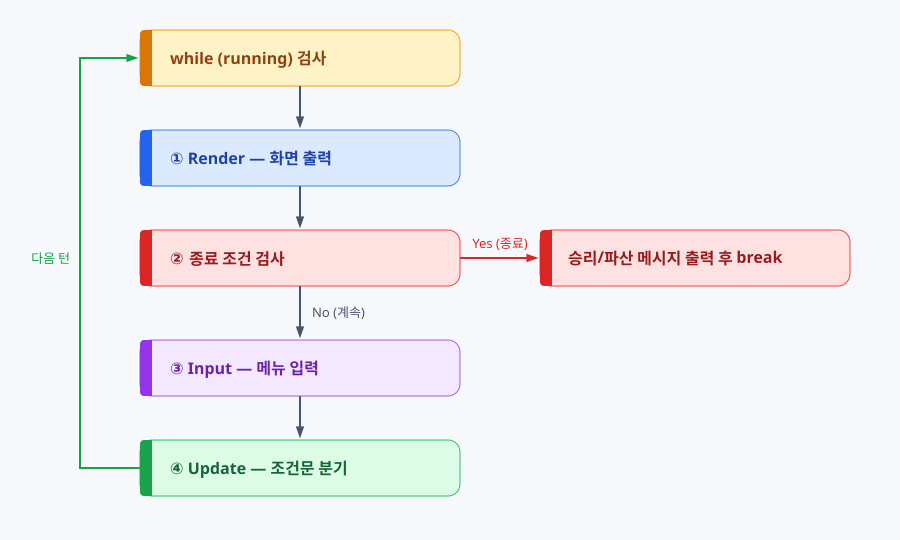

# TIL — 제어문(if와 switch)과 반복문(for와 while)

## 배운 개념

### 1. 조건문
조건식의 `true`/`false` 여부에 따라 코드 실행 흐름 제어

* **`if` / `else if` / `else` 문**:
  * 조건을 위에서부터 순차 평가 후 처음 `true`가 되는 블록 실행
  * C#에서는 조건식 결과의 `bool` 타입 강제 (정수 `0`, `1` 사용 불가)
  * 범위 비교(`hp <= 30`) 및 논리 연산자(`&&`, `||`)가 결합된 복합 조건 처리에 적합
* **`switch` 문**:
  * 변수 값을 여러 `case`의 상수 패턴과 비교하여 분기
  * 실행 코드가 있는 `case`에서 `break`나 `return` 생략(Fall-through) 컴파일러 차원의 엄격한 금지 (빈 `case` 연속 배치로 묶기만 허용)
  * 일치하는 `case` 부재 시 `default` 블록 실행
* **조건문 선택 기준**: 범위나 복잡한 논리 판단에는 `if`, `enum`(열거형)이나 명확한 상태 값 분기에는 `switch` 사용 권장

### 2. 반복문
특정 조건이 만족되는 동안 코드 블록을 반복 실행

* **`for` 문**:
  * 초기식, 조건식, 증감식을 한 줄에 명시하여 반복 횟수가 명확할 때 사용
  * 배열, 리스트의 인덱스 순회나 정해진 횟수만큼의 로직(예: 몬스터 스폰, 콤보 타격) 처리에 적합
* **`while` 문**:
  * 조건식이 `true`인 동안 계속 반복하며, 종료 시점이 유동적일 때 사용
  * 루프 내부에서 조건을 변경하지 않으면 무한 루프에 빠질 위험이 있으므로 탈출 조건(`break`)이나 상태 갱신 필수
  * `do-while` 문은 조건 검사 전 코드 블록을 최소 1회 먼저 실행
* **반복문 제어 키워드**: `break`(반복문 즉시 탈출), `continue`(현재 회차만 건너뛰고 다음 반복으로 이동)
* **반복문 선택 기준**: 반복 횟수가 정해져 있으면 `for`, 특정 조건이나 상태가 바뀔 때까지 계속 돌려야 하면 `while` 사용 권장

---

## 확인한 코드와 결과

### 1. `if-else` 문으로 체력 상태 분기
```csharp
using System;

int playerHp = 25;

if (playerHp <= 0)
{
    Console.WriteLine("상태: 게임 오버");
}
else if (playerHp <= 30)
{
    Console.WriteLine("상태: 위험 (체력 회복 필요)");
}
else
{
    Console.WriteLine("상태: 양호");
}
```
* **실행 결과**: `상태: 위험 (체력 회복 필요)`
* **분석**: `playerHp` 값이 `25`이므로 첫 번째 조건(`<= 0`) 생략 후 두 번째 조건(`<= 30`) 블록만 실행 및 종료

### 2. `enum`과 `switch` 문으로 게임 상태 분기
```csharp
using System;

enum GameState
{
    Menu,
    Playing,
    Paused,
    GameOver
}

GameState currentState = GameState.Playing;

switch (currentState)
{
    case GameState.Menu:
        Console.WriteLine("메인 메뉴 렌더링");
        break;
    case GameState.Playing:
        Console.WriteLine("게임 루프 실행");
        break;
    case GameState.Paused:
        Console.WriteLine("게임 일시정지");
        break;
    case GameState.GameOver:
        Console.WriteLine("결과 화면 표시");
        break;
    default:
        Console.WriteLine("알 수 없는 상태");
        break;
}
```
* **실행 결과**: `게임 루프 실행`
* **분석**: `GameState` 열거형과 `switch` 조합을 통한 문자열 오타 방지 및 안전한 상태 분기 구현

### 3. `for` 문으로 몬스터 웨이브 생성
```csharp
using System;

int totalMonsters = 3;

for (int i = 1; i <= totalMonsters; i++)
{
    Console.WriteLine($"웨이브 1 - 몬스터 {i}번 스폰 완료");
}
```
* **실행 결과**:
  ```text
  웨이브 1 - 몬스터 1번 스폰 완료
  웨이브 1 - 몬스터 2번 스폰 완료
  웨이브 1 - 몬스터 3번 스폰 완료
  ```
* **분석**: `i`가 `1`부터 `totalMonsters(3)` 이하일 때까지 1씩 증가하며 정해진 횟수만큼 정확히 3회 반복 실행

### 4. `while` 문으로 턴제 전투 루프 구현
```csharp
using System;

int bossHp = 50;
int playerDamage = 20;

while (bossHp > 0)
{
    bossHp -= playerDamage;
    Console.WriteLine($"플레이어 공격! 보스 남은 체력: {Math.Max(0, bossHp)}");
}

Console.WriteLine("보스 처치 완료!");
```
* **실행 결과**:
  ```text
  플레이어 공격! 보스 남은 체력: 30
  플레이어 공격! 보스 남은 체력: 10
  플레이어 공격! 보스 남은 체력: 0
  보스 처치 완료!
  ```
* **분석**: 공격 횟수를 미리 지정하지 않고 `bossHp > 0` 조건이 유지되는 동안 루프를 지속하며, 체력이 `0` 이하가 되는 순간 루프를 빠져나와 종료 메시지 출력

---

## 다음 실험
* C# `switch` 식(Switch Expression)과 관계 패턴(`<=`, `>`)을 활용한 `if-else` 코드 축약
* 빈 `case` 레이블 연속 배치를 통한 다중 상태 동일 로직 처리 테스트
* 컬렉션(배열, `List<T>`) 순회에 특화된 `foreach` 문과 일반 `for` 문의 성능 및 활용 차이 비교
* `while` 루프와 `switch` 결합을 통한 콘솔 기반 간단 게임 루프 구현


